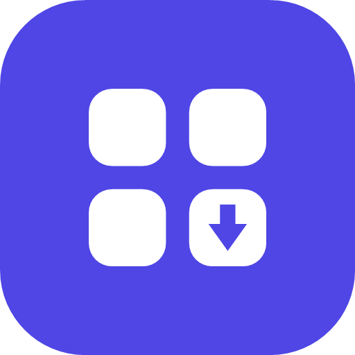
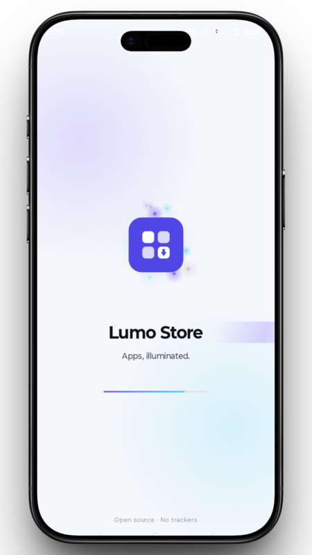
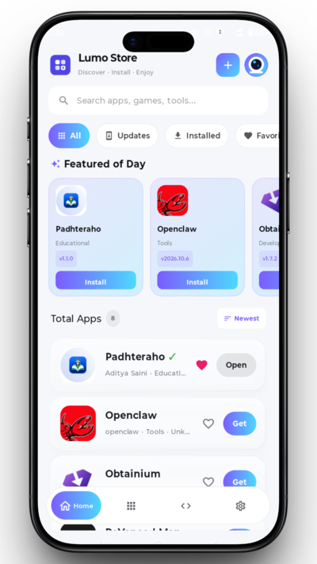
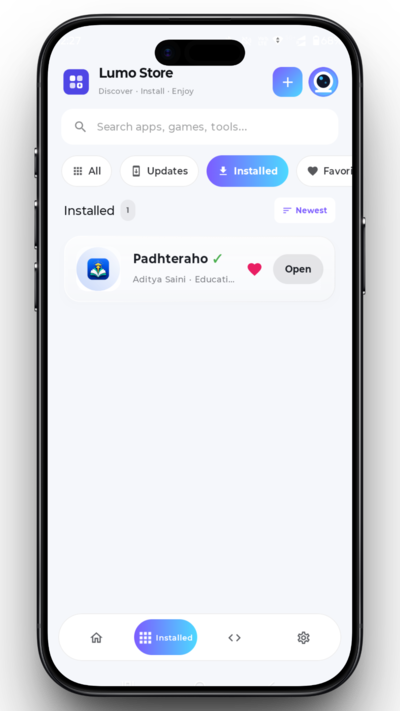
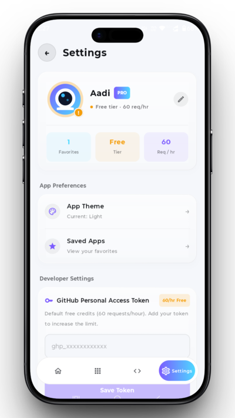
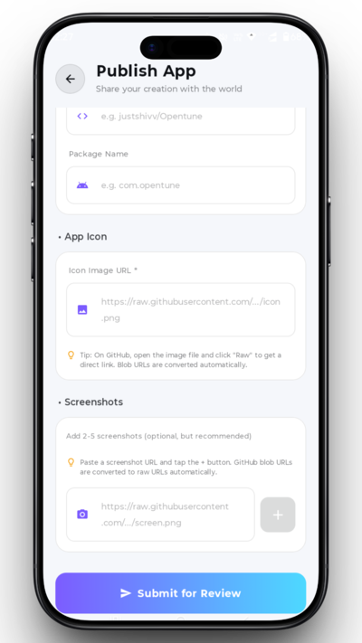
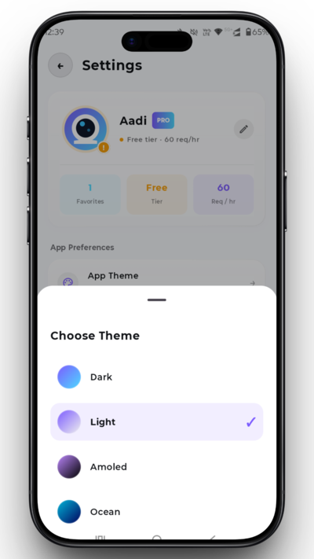

 <div align="center">



# LUMO STORE

### Your apps. Your freedom. Your choice.

**A free, open-source app store for Android.**

Discover, explore, and update open-source Android apps through a transparent, community-driven catalog — without requiring a private application backend.

<br />

[](https://github.com/adityasaini404/LumoStore/stargazers)
[](https://github.com/adityasaini404/LumoStore/network/members)
[](LICENSE)
[](https://github.com/adityasaini404/LumoStore/releases)

<br />

[**Download Lumo Store**](https://github.com/adityasaini404/LumoStore/releases) · [**Features**](#-features) · [**Screenshots**](#-screenshots) · [**Contributing**](#-contributing) · [**Report a Bug**](https://github.com/adityasaini404/LumoStore/issues)

<br />


</div>

---

## ✦ At a glance

<table>
<tr>
<td width="50%" valign="top">

### ◈ Privacy-minded

Browse the public catalog without creating an account. The catalog does not require a private application backend.

</td>
<td width="50%" valign="top">

### ◈ Fast by design

A precomputed `mirror.json` keeps catalog loading lightweight by serving prepared release metadata.

</td>
</tr>
<tr>
<td width="50%" valign="top">

### ◈ Open by default

Explore the source code, inspect the catalog, and contribute through GitHub.

</td>
<td width="50%" valign="top">

### ◈ Built for Android

A native Android experience powered by Kotlin, Jetpack Compose, and Material 3.

</td>
</tr>
</table>

---

<div align="center">

## 📸 Screenshots

Explore the interface — select any screenshot to view it in full size.

</div>

> **Tip:** On desktop, scroll horizontally through the screenshot row if your GitHub view allows it. Click an image to open the original screenshot.

<table>
<tr>
<td align="center" valign="top" width="220">
<a href="assets/screenshots/splashscreen.png">

</a>
<br /><br />
<strong>🎬 Splash Screen</strong>
<br />
<sub>Animated launch experience</sub>
</td>
<td align="center" valign="top" width="220">
<a href="assets/screenshots/home.png">

</a>
<br /><br />
<strong>🏠 Home</strong>
<br />
<sub>Featured apps, search, and categories</sub>
</td>
<td align="center" valign="top" width="220">
<a href="assets/screenshots/installedapps.png">

</a>
<br /><br />
<strong>📦 Installed Apps</strong>
<br />
<sub>Installed applications and updates</sub>
</td>
<td align="center" valign="top" width="220">
<a href="assets/screenshots/settings.png">

</a>
<br /><br />
<strong>⚙️ Settings</strong>
<br />
<sub>Theme, profile, and preferences</sub>
</td>
<td align="center" valign="top" width="220">
<a href="assets/screenshots/publishapp.png">

</a>
<br /><br />
<strong>📤 Publish App</strong>
<br />
<sub>Submit apps with visual previews</sub>
</td>
<td align="center" valign="top" width="220">
<a href="assets/screenshots/theme.png">

</a>
<br /><br />
<strong>🎨 Themes</strong>
<br />
<sub>Explore 13+ handcrafted themes</sub>
</td>
</tr>
</table>

<div align="center">

<br />

[**View All Releases**](https://github.com/adityasaini404/LumoStore/releases) · [**Explore the Website →**](https://adityasaini404.github.io/LumoStore/)

</div>

---

## ✨ Features

| Feature | Description |
|---|---|
| 🔍 **Smart Discovery** | Search, browse categories, and explore featured apps. |
| ⚡ **Mirror-Powered Catalog** | Prepared release metadata served through `mirror.json`. |
| 🎨 **13+ Themes** | Dark, Light, AMOLED, Ocean, Cyberpunk, Forest, Sunset, Sakura, Dracula, Nord, Coffee, and iPhone-inspired themes. |
| 👤 **Custom Profile** | Choose a display name and a hand-drawn Robot, Cat, Astronaut, or Alien avatar. |
| 🛡️ **VirusTotal Links** | Open an APK scan when a corresponding scan is available. |
| 🔑 **Optional GitHub Token** | Use without a personal token; an optional PAT can support higher API limits for compatible requests. |
| 📦 **Native Install Flow** | Download APK files with progress tracking and an installation flow. |
| ➕ **Community Submissions** | Submit app suggestions through the in-app contribution flow. |
| ❤️ **Favorites** | Keep preferred apps easy to find. |
| 🌐 **Open Source** | Public source code under the MIT license. |

---

## 🧭 Why Lumo Store?

Many app stores depend on accounts, centralized services, or complex infrastructure. Lumo Store takes a simpler approach.

Its public catalog is maintained as JSON, while GitHub Actions periodically builds a release mirror. The Android client reads the prepared catalog instead of independently querying GitHub for every app.

**The goal:** make discovering open-source Android apps easier while keeping the data and implementation inspectable.

### How the catalog works

```text
apps.json
    │
    ▼
GitHub Actions
Scheduled mirror build
    │
    ▼
mirror.json
    │
    ▼
Lumo Store
    │
    ▼
Browse · Search · Discover
```

---

## 🛠️ Tech Stack

- **Language:** Kotlin
- **UI:** Jetpack Compose
- **Design:** Material 3
- **Platform:** Android
- **Catalog:** JSON and a generated release mirror
- **Automation:** GitHub Actions
- **License:** MIT

---

## 🚀 Getting Started

1. Open the [Releases](https://github.com/adityasaini404/LumoStore/releases) page.
2. Download the available APK.
3. Install it on your Android device, allowing installation from your chosen source if Android requests permission.
4. Open Lumo Store and start discovering apps.

For source code and development, clone the repository:

```bash
git clone https://github.com/adityasaini404/LumoStore.git
```

Open the project in Android Studio and let Gradle sync before running the application.

---

## 🤝 Contributing

Contributions, suggestions, and bug reports are welcome.

1. Explore the existing [issues](https://github.com/adityasaini404/LumoStore/issues).
2. Fork the repository.
3. Create a branch for your changes.
4. Commit your work and open a pull request.

For app suggestions, use the contribution flow available in Lumo Store, where supported.

---

## 🐛 Report a Bug

Found an issue or have an idea?

[**Open a GitHub Issue →**](https://github.com/adityasaini404/LumoStore/issues/new)

Please include the steps to reproduce the issue, expected behavior, actual behavior, and relevant screenshots or logs when possible.

---

## 📄 License

Lumo Store is distributed under the [MIT License](LICENSE).

---

<div align="center">

**LUMO STORE**

*Your apps. Your freedom. Your choice.*

Made for an open Android ecosystem.

[GitHub Repository](https://github.com/adityasaini404/LumoStore) · [Releases](https://github.com/adityasaini404/LumoStore/releases) · [Website](https://adityasaini404.github.io/LumoStore/)

</div>
